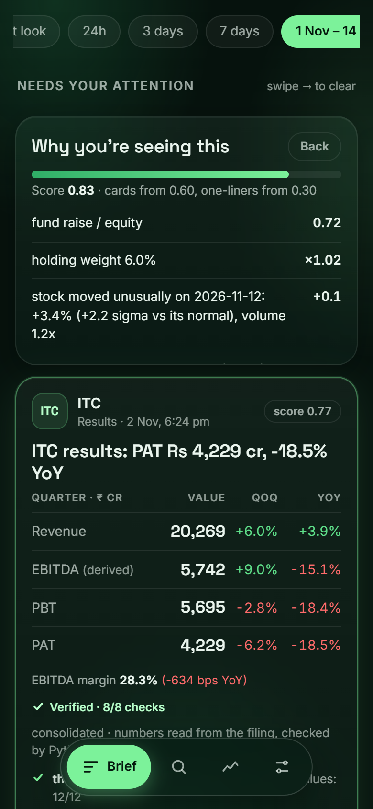
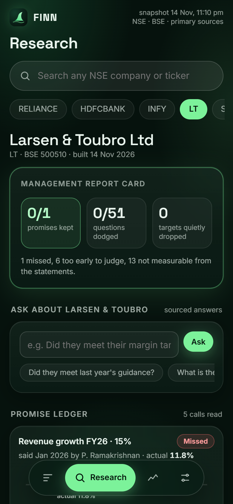
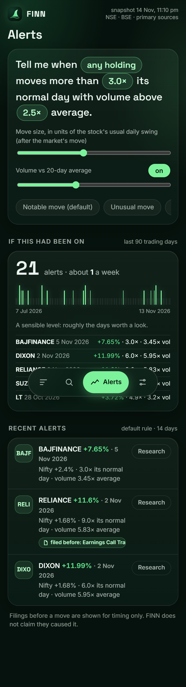
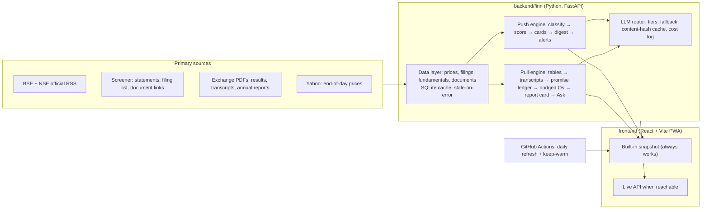

# FINN

**What your holdings filed, what actually matters, and whether management keeps its word.**

Indian listed companies file dozens of exchange announcements a week; almost all are paperwork.
FINN reads every filing for your portfolio, ranks it by how much it should interrupt you, and turns the
few that matter into verified cards: results with numbers checked by Python against a second source,
management changes with career lines quoted from the filing, price moves judged against each stock's own
normal day. On demand, it reads any company's last five earnings calls and annual report and keeps a
**promise ledger**: every target management set, measured against what the company later reported, with
the exact quote and page. Every number is computed in Python; every quote is checked word for word.

| Brief | Why this card? | Promise ledger | Alerts backtest |
|---|---|---|---|
|  |  |  |  |

All 20 screens and states: [`frontend/screenshots/`](frontend/screenshots/) (iPhone size, 0 console errors, 0 accessibility issues).

---

## How FINN thinks: filter → rank → verify

1. **Filter.** Every filing is sorted into ENAM's 17 categories by ordered rules (results, M&A, management change…).
   Gemini Flash-Lite reads page 1 only when no rule is sure. Routine paperwork is collapsed, never deleted.
2. **Rank.** `score = base(category, sub-type) × event modifiers (CEO vs company secretary, abrupt vs planned,
   size vs market cap) × holding weight × your preferences + market-reaction bonus`. Hero ≥ 0.6, one-liner ≥ 0.3.
   Every factor is shown when you tap **Why?**.
3. **Verify.** The model only *reads*; Python *checks*:
   - results: three periods 3 and 12 months apart, PBT − tax = PAT, totals add up, units, and agreement with
     Screener's table, before a "verified" badge;
   - quotes: found word for word on the cited page, or dropped;
   - summaries: every number must appear in the filing, no praise words without numbers, no verbs the filing
     doesn't use ("upgrade" when the rating was reaffirmed);
   - promises: Python measures the actual in the promise's own unit and period and decides the verdict.

## Architecture



- **Backend** (`backend/finn`): data layer, push engine (`push/`), pull engine (`pull/`), one LLM router (`llm.py`), FastAPI (`api.py`).
- **App** (`frontend/`): Brief (with any date range and **Play my brief**, read aloud on the phone), Research (with
  **Ask about this company**, answered only from its cited sources), Alerts, Settings; installable PWA; ships a snapshot
  of real outputs so the link always works, and uses the live backend (Render) for companies outside it.
- **Ops**: a GitHub Action rebuilds the data every weekday at 16:45 IST; another keeps the free backend awake.

## Model routing and measured cost

Rules first; the model only where rules can't do the job. One router (`backend/finn/llm.py`) picks the tier,
falls back if a model fails (and labels it), caches every answer by a hash of its exact input, and logs tokens.

| Task | Tier | Real calls | Answered from cache | Tokens |
|---|---|---|---|---|
| Promise extraction | Flash-Lite | 99 | 268 | 118k |
| Dodged-question labels | Flash-Lite | 83 | 74 | 640k |
| One-line summaries | Flash-Lite (Flash retry) | 34 | 166 | 41k |
| Results tables (from PDF pages) | Flash-Lite → Flash if checks fail | 17 | 32 | 72k |
| Bull / bear phrasing | Flash-Lite | 46 | 29 | 37k |
| Filing classification (rules unsure) | Flash-Lite | 19 | 76 | 16k |
| Segment tables | Flash-Lite | 18 | 46 | 23k |
| People cards | Flash-Lite | 3 | 0 | 12k |
| Ask about a company | Flash (Flash-Lite fallback) | 4 | 0 | 25k |
| **Total, whole build (14 Nov 2026)** | | **≈ 331** | **≈ 731** | **≈ 1.02 M** |

All on Gemini's free tier: **USD 0**. Two thirds of all model requests were answered from the cache. The app's
Settings screen shows a live cost meter.

## Evaluation (honest numbers; details in the linked files)

| What | Result | Where |
|---|---|---|
| Filing category, 90 hand-labelled real filings of the 18 holdings | rules + Gemini **100%**; hero / one-liner / collapsed **98%** | `backend/push_report.md` |
| Same, 34 other companies, first blind pass | rules alone **53%**, rules + Gemini **82%** (later fixes are in-sample) | `backend/push_report.md` |
| Results cards | ITC (quarterly, excise-adjusted), Happiest Minds and Team24 (scanned PDFs), Transteel and Oriana (half-yearly SME) **all verified**; 8/8 checks incl. a match with Screener | `backend/push_report.md` |
| Promise ledger, hand check of 45 L&T + HAL statements | extraction **45/45** genuine and verbatim; verdicts **4/7 first pass → 8/8** after generic fixes | `backend/spot_check.md` |
| Dodged questions, 224 pairs, hand check of 15 labels | "dodged" precision **2/2**; overall agreement **12/15** (misses err towards not accusing) | `backend/spot_check.md` |
| Data layer, 5 companies live | prices, statements, transcripts, filings from this PC; last close within **0.13%** of a second source | `backend/validation_report.md` |
| Tests | **113** offline tests (backend) on real captured responses and recorded model answers | `backend/tests/` |

## Key decisions and trade-offs

The full log with "what we gave up" is in [`DECISIONS.md`](DECISIONS.md). The ones that shaped FINN most:

- **Primary sources only, and no bot-protection workarounds.** BSE's and NSE's announcement APIs refuse scripted
  access; FINN uses their official RSS feeds plus Screener's filing list and says when coverage may be incomplete.
- **The model reads, Python decides.** No LLM arithmetic, no LLM verdicts where a number exists.
- **A wrong number is worse than no number.** Cards that fail checks say "not verified" and link the filing.
- **The obvious alert was too noisy.** A 2.5-sigma rule fired ~3 times a week across 18 stocks in the 90-day
  backtest; the default became "3 sigma *and* 2.5× volume" (~1 a week). The app shows the backtest live.
- **Snapshot + live.** The deployed link works even if the free backend sleeps; new companies go live.

## What we left out (and why)

- **Paid or licensed feeds** (BSE/NSE APIs, broker data): not free; filing history before the RSS poller started is thinner.
- **LinkedIn or web search for people:** scraping is against their terms; people cards use the filing's own profile.
- **Constant-currency and segment guidance verdicts:** the statements report INR, company-wide; FINN labels these
  "not measurable" instead of converting or guessing.
- **OCR for scanned annual reports:** scanned results go to Gemini as images; scanned 300-page reports are skipped.

## What's next

- Run the RSS poller continuously so the filing history fills in (Render does this while awake).
- Push notifications for hero cards and alerts (the service worker is in place).
- Analyst-question topics over time (what the Street keeps asking, and whether answers improve).
- A larger blind evaluation set for the classifier and the dodged-question judge.

## Run it locally

```bash
# backend (Python 3.12+)
python -m venv .venv && .venv/Scripts/pip install -r backend/requirements.txt   # Windows path; use .venv/bin on macOS/Linux
cp .env.example .env          # add GEMINI_API_KEY
cd backend
python -m pytest              # 113 offline tests
uvicorn finn.api:app --port 8000

# app
cd frontend
npm install
npm run dev                   # http://localhost:5173 (uses the local backend automatically)
```

Refresh the app's data: `python -m finn.export_snapshot` (in `backend/`). Deploy: see [`DEPLOY.md`](DEPLOY.md).
Demo path: [`DEMO.md`](DEMO.md). Project rules: [`CLAUDE.md`](CLAUDE.md). Build history: [`build-history/`](build-history/).
